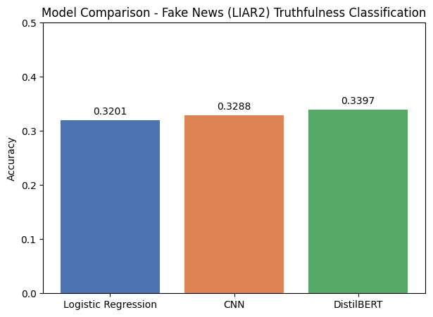

# Fake News Truthfulness Classifier (LIAR2)

A 6-class text classification project that rates political statements on a truthfulness scale, from Pants-fire to True, using the LIAR2 dataset. Three models were built and compared: Logistic Regression, CNN, and DistilBERT.

## Dataset

- **Source:** LIAR2 (`ucsbnlp/liar`), an expanded version of the original LIAR dataset from PolitiFact
- **Training set:** 18,369 statements
- **Test set:** 2,296 statements
- **Classes:** 0 = Pants-fire, 1 = False, 2 = Barely-true, 3 = Half-true, 4 = Mostly-true, 5 = True
- **Note:** Classes are imbalanced (False is most common at 5,284 examples, True is least common at 2,068), reflecting real-world fact-checking patterns

## Models

| Model | Approach |
|---|---|
| Logistic Regression | TF-IDF vectorization (5,000 features) |
| CNN | Embedding + Conv1D + GlobalMaxPooling, with early stopping |
| DistilBERT | Fine-tuned `distilbert-base-uncased`, 2 epochs |

## Results

| Model | Accuracy |
|---|---|
| Logistic Regression | 32.01% |
| CNN | 32.88% |
| DistilBERT | 33.97% |

All three models perform similarly, well above the 16.7% random baseline for 6-class classification but far from high accuracy — this reflects the genuine difficulty of judging truthfulness from short statement text alone, without external fact-checking. DistilBERT's precision/recall on the rarest class ("True") was notably weak, highlighting a limitation beyond raw accuracy.

## Project Structure

- lr_model.pkl / tfidf_vectorizer.pkl — Logistic Regression model and vectorizer
- cnn_model.keras / tokenizer.pkl — CNN model and tokenizer
- bert_results/ — DistilBERT training checkpoints (not tracked in GitHub due to size)
- plots/ — All generated plots (confusion matrices, ROC curves, training curves)
- REPORT.md / REPORT.pdf — Full project report

## Requirements

- datasets
- scikit-learn
- tensorflow
- transformers
- evaluate
- matplotlib, seaborn

## Usage

Load any saved model with its corresponding preprocessing tool (vectorizer/tokenizer) to run predictions on new political statements. See REPORT.md for full details, including per-class performance and discussion of the class imbalance issue.
